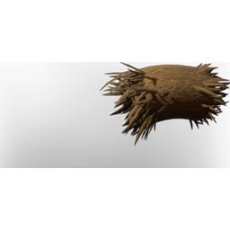

# Treehouse Material

| | |
|---|---|
| Category | [Materials](../../categories/materials.md) |
| Rarity | ⚪ Common |
| Level | - |
| Max stack | 250 |
| Item ID | `3577968307` |
| Internal name | `Build_TerrainMaterial_T2_TallTree_TreeHouseHull` |

## Description

A complicated nesting material, used for building extravagant tree houses.

## Where to find

Blackmire

---

[← Materials](../../categories/materials.md) · [All categories](../../README.md)
