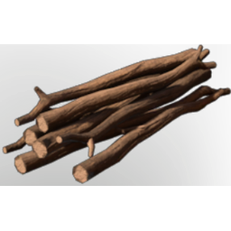

# Twig

| | |
|---|---|
| Category | [Materials](../../categories/materials.md) |
| Rarity | ⚪ Common |
| Level | 1 |
| Max stack | 250 |
| Item ID | `1798662696` |
| Internal name | `Material_T1_Twigs` |

## Description

A twig, as insignificant as it might seem, has a lot of potential. Everything starts somewhere...

## How to get it

- **Table Saw**: 1 × one of: [Wood Logs](../../items/materials/wood-logs-722268629.md) / [Hardwood](../../items/materials/hardwood-1765656585.md) / [Palmwood Logs](../../items/materials/palmwood-logs-2955233340.md) / [Conifer Logs](../../items/materials/conifer-logs-1475408789.md) / … (6 options) → 5 ×

## Used to make

[Summoning Scepter](../../items/buildtools/summoning-scepter-1182285312.md), [Simple Fishing Rod](../../items/buildtools/simple-fishing-rod-425570534.md), [Stone Axe](../../items/tools/stone-axe-497414641.md), [Stone Pickaxe](../../items/buildtools/stone-pickaxe-623229764.md), [Plaited Block](../../items/buildtools/plaited-block-2762553617.md), [Torch](../../items/weapons/torch-3474096535.md), [Wooden Arrow](../../items/ammunition/wooden-arrow-2956941513.md), [Celesthium Steel Arrow](../../items/ammunition/celesthium-steel-arrow-2519697782.md), [T7 Blunt Arrow](../../items/ammunition/t7-blunt-arrow-1677413497.md), [Moonstone Piercing Arrow](../../items/ammunition/moonstone-piercing-arrow-832661139.md), [Golden Steel Arrow](../../items/ammunition/golden-steel-arrow-3634108976.md), [Steel Arrow](../../items/ammunition/steel-arrow-3559583218.md), [Obsidian Arrow](../../items/ammunition/obsidian-arrow-2172551026.md), [Iron Arrow](../../items/ammunition/iron-arrow-1454438654.md), [Bronze Arrow](../../items/ammunition/bronze-arrow-3990911183.md), [Fossilized Bone Arrow](../../items/ammunition/fossilized-bone-arrow-1536235498.md), [Copper Arrow](../../items/ammunition/copper-arrow-4046432840.md), [Scrap Arrow](../../items/ammunition/scrap-arrow-1729479389.md), [Flint Arrow](../../items/ammunition/flint-arrow-1422216404.md), [Shroud Arrow III](../../items/ammunition/shroud-arrow-iii-3333535459.md), [Shroud Arrow II](../../items/ammunition/shroud-arrow-ii-4214162606.md), [Fog Arrow](../../items/ammunition/fog-arrow-3761680048.md), [Stun Arrow](../../items/ammunition/stun-arrow-2371220722.md), [Kiln](../../items/buildtools/kiln-21592019.md), [(Butterfly Lover Bush) Seedling](../../items/buildtools/butterfly-lover-bush-seedling-1785286209.md), [Cactus Seedling](../../items/buildtools/cactus-seedling-3704150172.md), [Tree Seedling "Tree 03 Steppes"](../../items/buildtools/tree-seedling-tree-03-steppes-352277981.md), [Tree Seedling "Tree 02 Steppes"](../../items/buildtools/tree-seedling-tree-02-steppes-3795599645.md), [Laurel Tree Seedling](../../items/buildtools/laurel-tree-seedling-2936889942.md), [Tree Seedling "Tree 02 Deepwoods"](../../items/buildtools/tree-seedling-tree-02-deepwoods-3622968297.md), [Tree Seedling "Tree 03 Deepwoods"](../../items/buildtools/tree-seedling-tree-03-deepwoods-4117633993.md), [Willow Tree Seedling](../../items/buildtools/willow-tree-seedling-2668074164.md), [Tree Seedling](../../items/buildtools/tree-seedling-688553119.md), [Wax Torch](../../items/weapons/wax-torch-3913483832.md), [Resin Torch](../../items/weapons/resin-torch-531354159.md), [Improvised Bow](../../items/weapons/improvised-bow-3527909057.md), [Bed T2 Talltree Nest](../../items/buildtools/bed-t2-talltree-nest-2929854543.md), [Firefly Standing Basket](../../items/buildtools/firefly-standing-basket-245164403.md), [Scarecrow](../../items/buildtools/scarecrow-2938349424.md), [Violet Decorative Box](../../items/buildtools/violet-decorative-box-2054426662.md) and 15 more

---

[← Materials](../../categories/materials.md) · [All categories](../../README.md) · [JSON](twig-1798662696.json)
