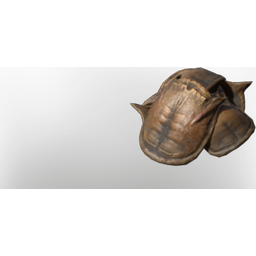

# Wildbeast Scales (Scorpion and maybe SandDigger)

| | |
|---|---|
| Category | [Materials](../../categories/materials.md) |
| Rarity | ⚪ Common |
| Level | 40 |
| Max stack | 250 |
| Item ID | `3553538325` |
| Internal name | `Material_T7_WildBeast_Scales` |

## Description

Wildbeast scales, ver strudy and robust, can even withstand lava

## Where to find

Enemies, Ancientland

## Used to make

[T7 Eternal Ice Bolt IV](../../items/ammunition/t7-eternal-ice-bolt-iv-1144190206.md), [T7 Ice Bolt IV](../../items/ammunition/t7-ice-bolt-iv-780965247.md), [T7 Eternal Entangle](../../items/ammunition/t7-eternal-entangle-967466975.md), [Vorgoth's Gloves](../../items/equipment/vorgoth-s-gloves-3158681634.md)

---

[← Materials](../../categories/materials.md) · [All categories](../../README.md) · [JSON](wildbeast-scales-scorpion-and-maybe-sanddigger-3553538325.json)
