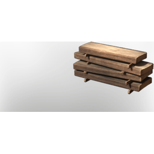

# Wood Planks

| | |
|---|---|
| Category | [Materials](../../categories/materials.md) |
| Rarity | ⚪ Common |
| Level | 13 |
| Max stack | 250 |
| Item ID | `1626290897` |
| Internal name | `Material_T2_Wood_Planks` |

## Description

Planks created by cutting the Wood Logs in a desired shape. A stylistic and useful natural element that has yet to reach the desired end of production.

## Where to find

Crafting, Table Saw

---

[← Materials](../../categories/materials.md) · [All categories](../../README.md)
