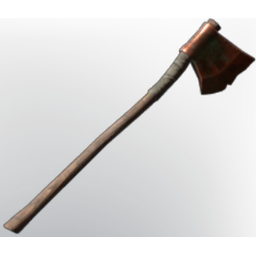

# Copper Axe

| | |
|---|---|
| Category | [Tools](../../categories/tools.md) |
| Rarity | 🟢 Uncommon |
| Level | 10 |
| Max stack | 1 |
| Item ID | `1978632298` |
| Internal name | `Tool_T2_Axe_Copper_Deepwoods` |

## Description

A sharp copper axe, that is highly efficient at cutting wood, but can also be used to cut down enemies.

## Stats

| | |
|---|---|
| Slot | Tool |
| Damage type | Cutting |
| Stamina Cost | 3 |
| Attack Speed | 0.774 s |

## Enhancements

Unlocked one after another as the item is upgraded, in this order. Armor and damage bonuses grow with the item level, so their numbers are shown in game only.

| | Enhancement | Effect |
|:---:|---|---|
| 1 | Enduring | +6 Enduring |
| 2 | Stamina | +8 Stamina |
| 3 | +1 Lumberjack | Increases the skill level of Lumberjack by +1 |

## How to get it

- **Blacksmith**: 3 × [String](../../items/materials/string-419344916.md), 4 × [Copper Bar](../../items/materials/copper-bar-170689373.md), 1 × [Hardwood](../../items/materials/hardwood-1765656585.md) → 1 ×

---

[← Tools](../../categories/tools.md) · [All categories](../../README.md) · [JSON](copper-axe-1978632298.json)
