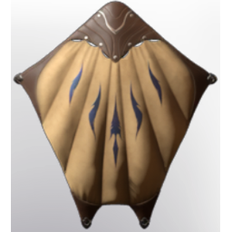

# Extraordinary Glider

| | |
|---|---|
| Category | [Tools](../../categories/tools.md) |
| Rarity | 🟣 Epic |
| Level | 20 |
| Max stack | 1 |
| Item ID | `284247111` |
| Internal name | `Tool_Glider_T3` |

## Description

This glider will allow you to travel extraordinary long distances.

## Stats

| | |
|---|---|
| Slot | Glider |
| Stamina per Second | 5 |
| Speed | 20 |
| Range | 200 |

## How to get it

- **Carpenter**: 4 × [Fog Wood](../../items/materials/fog-wood-1320899587.md), 2 × [Leather](../../items/materials/leather-4135223598.md), 2 × [Linnen](../../items/materials/linnen-1815424180.md), 15 × [Shroud Adhesive](../../items/materials/shroud-adhesive-1047122195.md) → 1 ×

---

[← Tools](../../categories/tools.md) · [All categories](../../README.md) · [JSON](extraordinary-glider-284247111.json)
