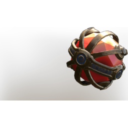

# Gem of Armoring

| | |
|---|---|
| Category | [Weapon Gems](../../categories/weapongem.md) |
| Rarity | 🟠 Legendary |
| Level | 1-105 |
| Max stack | 1 |
| Item ID | `2686813646` |
| Internal name | `T7_Gem_GemOfArmoring` |

## Description

Killing an enemy spawns an orb at the enemies location. Collecting the orb allows you to resist all damage for  %k.

## Stats

| | |
|---|---|
| Buff Duration | 1 s (scales with level) |

---

[← Weapon Gems](../../categories/weapongem.md) · [All categories](../../README.md)
