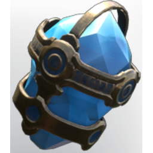

# Gem of Currents

| | |
|---|---|
| Category | [Weapon Gems](../../categories/weapongem.md) |
| Rarity | 🔵 Rare |
| Level | 1-105 |
| Max stack | 1 |
| Item ID | `1634845335` |
| Internal name | `T6_Gem_GemOfCurrents_OverFog` |

## Description

While Wet or Soaked, damaging enemies will apply Soaked to them for %k Sec. Damaging soaked enemies has a chance of %k to deal %k bonus shock damage.

## Stats

| | |
|---|---|
| Additional Weapon Shock Damage | 8 (scales with level) |
| Debuff Duration | 6 s (scales with level) |
| Trigger Chance on Hitting a Soaked Enemy | 33 (scales with level) |

---

[← Weapon Gems](../../categories/weapongem.md) · [All categories](../../README.md)
