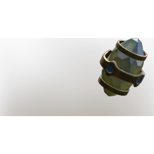

# Gem of Focused Light

| | |
|---|---|
| Category | [Weapon Gems](../../categories/weapongem.md) |
| Rarity | 🟠 Legendary |
| Level | 1-105 |
| Max stack | 1 |
| Item ID | `63026718` |
| Internal name | `T4_Gem_GemOfFocusedLight` |

## Description

Targeting an enemy for a few seconds while aiming or blocking puts a  mark on the enemy. Attacking the marked enemy deals %k addtional fire damage. The mark can stackup to 3 times, by continued targeting, increasing the bonus damage by %k at 2 stacks and %k at 3 stacks.

---

[← Weapon Gems](../../categories/weapongem.md) · [All categories](../../README.md)
