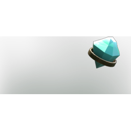

# Gem of Skulls

| | |
|---|---|
| Category | [Weapon Gems](../../categories/weapongem.md) |
| Rarity | 🟢 Uncommon |
| Level | 1-105 |
| Max stack | 1 |
| Item ID | `3928711197` |
| Internal name | `T1_Gem_GemOfSkulls` |

## Description

Killing a enemy with a visceral attack has a %k chance to spawn a friendly level %k flying skull

---

[← Weapon Gems](../../categories/weapongem.md) · [All categories](../../README.md)
