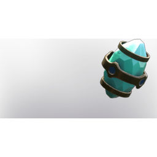

# Gem of Soul Reaping

| | |
|---|---|
| Category | [Weapon Gems](../../categories/weapongem.md) |
| Rarity | 🟣 Epic |
| Level | 1-105 |
| Max stack | 1 |
| Item ID | `173591857` |
| Internal name | `T4_Gem_GemOfSoulReaping` |

## Description

Damaging an enemy puts a   mark on them for %k.  Marked enemies spawn a soul phial on death that can be destroyed to heal you and your allies for %k in a 5m radius and also counts as an enemy kill for other effects.

## Stats

| | |
|---|---|
| Debuff Duration | 1:02 min |
| Health | 5 (scales with level) |

---

[← Weapon Gems](../../categories/weapongem.md) · [All categories](../../README.md) · [JSON](gem-of-soul-reaping-173591857.json)
