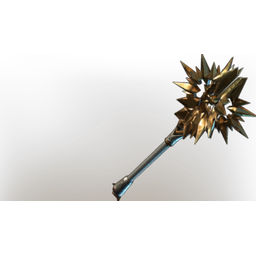

# Ancestral Star

| | |
|---|---|
| Category | [Weapons](../../categories/weapons.md) |
| Rarity | 🔵 Rare |
| Level | 36 |
| Max stack | 1 |
| Item ID | `1912269209` |
| Internal name | `Craft_Weapon_T6_2H_Lore_Hammer_townsfolk_male_01_hint_01` |

## Description

An ancestral weapon from the proud family line of the Galeforths, last held by Virgil Galeforth who famously said: "If you want this weapon, you'll have to pry it from my cold, dead hands".

---

[← Weapons](../../categories/weapons.md) · [All categories](../../README.md)
