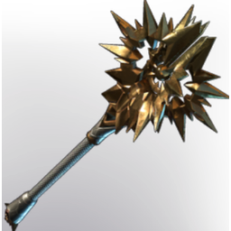

# Ancestral Star

| | |
|---|---|
| Category | [Weapons](../../categories/weapons.md) |
| Rarity | 🟠 Legendary |
| Level | 1-55 |
| Max stack | 1 |
| Item ID | `2226962572` |
| Internal name | `Weapon_T5_2H_Lore_Hammer_townsfolk_male_01_hint_01` |

One of 4 versions of this item: see [Ancestral Star](../../objects/weapons/ancestral-star.md) for all of them and how they differ.

## Description

An ancestral weapon from the proud family line of the Galeforths, last held by Virgil Galeforth who famously said: "If you want this weapon, you'll have to pry it from my cold, dead hands".

## Stats

| | |
|---|---|
| Slot | Melee weapon |
| Damage type | Blunt 50%, Fire 50% |
| Parry Power | 1 |
| Attack Speed | 0.774 s |

## Enhancements

Unlocked one after another as the item is upgraded, in this order. Armor and damage bonuses grow with the item level, so their numbers are shown in game only.

| | Enhancement | Effect |
|:---:|---|---|
| 1 | Precise | +6 Precise |
| 2 | Heavy | - |
| 3 | Precise | +6 Precise |
| 4 | Heavy | - |
| 5 | Retaliation | A percentage of incoming damage is dealt back to the attacker |

---

[← Weapons](../../categories/weapons.md) · [All categories](../../README.md) · [JSON](ancestral-star-2226962572.json)
