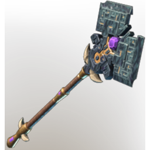

# Axe 2H T6 epic 01

| | |
|---|---|
| Category | [Weapons](../../categories/weapons.md) |
| Rarity | 🟠 Legendary |
| Level | 1-55 |
| Max stack | 1 |
| Item ID | `2628714681` |
| Internal name | `Weapon_T6_2H_GreatAxeEpic_01` |

## Description

Axe 2H  T6 epic  01 desc

## Stats

| | |
|---|---|
| Slot | Melee weapon |
| Damage type | Cutting 50%, Shroud 50% |
| Attack Speed | 0.774 s |
| Parry Power | 1 |

## Enhancements

Unlocked one after another as the item is upgraded, in this order. Armor and damage bonuses grow with the item level, so their numbers are shown in game only.

| | Enhancement | Effect |
|:---:|---|---|
| 1 | Chargeback | Defeat an enemy to restore Durability |
| 2 | Brutal | +22 Brutal |
| 3 | Heavy | - |
| 4 | Heavy | - |
| 5 | Brutal | +22 Brutal |

---

[← Weapons](../../categories/weapons.md) · [All categories](../../README.md) · [JSON](axe-2h-t6-epic-01-2628714681.json)
