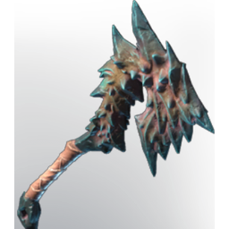

# Axe T6 common 01

| | |
|---|---|
| Category | [Weapons](../../categories/weapons.md) |
| Rarity | 🟠 Legendary |
| Level | 1-55 |
| Max stack | 1 |
| Item ID | `1541977934` |
| Internal name | `Weapon_T6_1H_Axe_01` |

## Description

Axe  T6 common  01  desc

## Stats

| | |
|---|---|
| Slot | Melee weapon |
| Damage type | Cutting |
| Attack Speed | 0.6 s |

## Enhancements

Unlocked one after another as the item is upgraded, in this order. Armor and damage bonuses grow with the item level, so their numbers are shown in game only.

| | Enhancement | Effect |
|:---:|---|---|
| 1 | Opportunistic | Increased critical hit chance against soaked enemies |
| 2 |  | - |
| 3 | Health Leech | +8 Health Leech |
| 4 | Heavy | - |
| 5 | Ruthless | Increased critical hit damage against soaked enemies |

---

[← Weapons](../../categories/weapons.md) · [All categories](../../README.md) · [JSON](axe-t6-common-01-1541977934.json)
