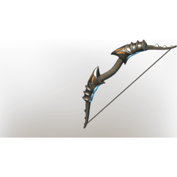

# Consumed fog soldier bow

| | |
|---|---|
| Category | [Weapons](../../categories/weapons.md) |
| Rarity | 🔵 Rare |
| Level | 21 |
| Max stack | 1 |
| Item ID | `4016669731` |
| Internal name | `Craft_Weapon_T4_2H_Lore_BowEpic_Ministory_15` |

One of 7 versions of this item: see [Consumed fog soldier bow](../../objects/weapons/consumed-fog-soldier-bow.md) for all of them and how they differ.

## Description

: A bow used by the northern guard. A violent and blind dedications flows through, increasing the user's pulse and quickening their shots.

## Stats

| | |
|---|---|
| Slot | Ranged weapon |
| Draw Speed | 0.6 s |
| Arrow Speed | 20 |

## Enhancements

Unlocked one after another as the item is upgraded, in this order. Armor and damage bonuses grow with the item level, so their numbers are shown in game only.

| | Enhancement | Effect |
|:---:|---|---|
| 1 | Heavy | - |
| 2 | Health Leech | +6 Health Leech |
| 3 | Heavy | - |
| 4 | Stamina Leech | On Hit Leech 5% Damage as Stamina |
| 5 | Heavy | - |

## How to get it

- **Hunter**: 4 × [Iron Bars](../../items/materials/iron-bars-159114158.md), 2 × [String](../../items/materials/string-419344916.md), 3 × [Palmwood Logs](../../items/materials/palmwood-logs-2955233340.md), 1 × [Goo](../../items/materials/goo-3403995938.md) → 1 ×

---

[← Weapons](../../categories/weapons.md) · [All categories](../../README.md) · [JSON](consumed-fog-soldier-bow-4016669731.json)
