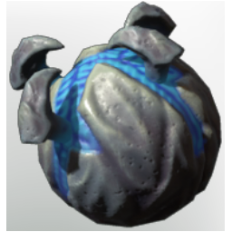

# Critter Crawler Bomb

| | |
|---|---|
| Category | [Weapons](../../categories/weapons.md) |
| Rarity | 🟢 Uncommon |
| Level | 35 |
| Max stack | 20 |
| Item ID | `3870359442` |
| Internal name | `Consumable_CritterCrawler_Bomb_Grenade_T5` |

## Description

Throw to send of an explosive critter crawler

## Where to find

Crafting, Alchemist

## Stats

| | |
|---|---|
| Slot | Magic weapon |
| Damage type | Fire 50%, Shroud 50% |
| Mana Cost | 95 |
| Duration | 12 s |
| Throw Interval | 1,000 |

## How to get it

- **Alchemist**: 10 × [Critter Carapace](../../items/materials/critter-carapace-1611805749.md), 1 × [Bones](../../items/materials/bones-2053375978.md) → 1 ×

---

[← Weapons](../../categories/weapons.md) · [All categories](../../README.md)
