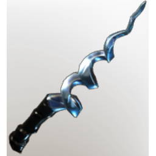

# Cryptic wand

| | |
|---|---|
| Category | [Weapons](../../categories/weapons.md) |
| Rarity | 🔵 Rare |
| Level | 26 |
| Max stack | 1 |
| Item ID | `2908736852` |
| Internal name | `Craft_Weapon_T5_1H_Lore_WandEpic_Ministory_09_Lightning` |

One of 7 versions of this item: see [Cryptic wand](../../objects/weapons/cryptic-wand.md) for all of them and how they differ.

## Description

A strange wand which was covered by ashes. Its body bends and twists, but never breaks.  - Multishot: Fires multiple projectiles but at reduced damage

## Stats

| | |
|---|---|
| Slot | Magic weapon |
| Damage type | Lightning |
| Overcharge | 22 |
| Attack Speed | 0.6 s |
| Mana Regeneration | 10 |
| Multishot | 1 |

## Enhancements

Unlocked one after another as the item is upgraded, in this order. Armor and damage bonuses grow with the item level, so their numbers are shown in game only.

| | Enhancement | Effect |
|:---:|---|---|
| 1 | Heavy | - |
| 2 | Mana Leech | +7 Mana Leech |
| 3 | Heavy | - |
| 4 | Chargeback | Defeat an enemy to restore Durability |
| 5 | Chargeback | Defeat an enemy to restore Durability |

## How to get it

- **Alchemist**: 4 × [Glass](../../items/materials/glass-2246309017.md), 3 × T5 Silver Dust, 5 × T5 Material Amethyst, 2 × [Flammable Goo](../../items/materials/flammable-goo-887761434.md) → 1 ×

---

[← Weapons](../../categories/weapons.md) · [All categories](../../README.md)
