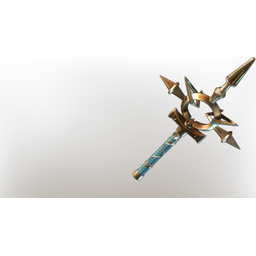

# Darya's Remorse

| | |
|---|---|
| Category | [Weapons](../../categories/weapons.md) |
| Rarity | 🔵 Rare |
| Level | 46 |
| Max stack | 1 |
| Item ID | `3233786830` |
| Internal name | `Craft_Weapon_T7_1H_Lore_Wand_ministory_06_fog` |

One of 2 versions of this item: see [Darya's Remorse](../../objects/weapons/darya-s-remorse.md) for all of them and how they differ.

## Description

A heavy wand that's bright as the sun, decorated by a flower that wraps around the handle, blooming near the hilt. Despite it's radiance, you feel that it carried a dark energy - is it remorse, or the curse of the Shroud?

## Stats

| | |
|---|---|
| Slot | Magic weapon |
| Damage type | Shroud |
| Overcharge | 30 |
| Attack Speed | 0.6 s |
| Mana Regeneration | 16 |
| Multishot | 1 |
| Ethereal Duplication | 30 |

## Enhancements

Unlocked one after another as the item is upgraded, in this order. Armor and damage bonuses grow with the item level, so their numbers are shown in game only.

| | Enhancement | Effect |
|:---:|---|---|
| 1 | Heavy | - |
| 2 | Precise | +7 Precise |
| 3 | Heavy | - |
| 4 | Brutal | +24 Brutal |
| 5 | Heavy | - |

## How to get it

- **Alchemist**: 10 × [Bones](../../items/materials/bones-2053375978.md), 4 × [Diamond Dust](../../items/materials/diamond-dust-1725874983.md), 4 × [Glass](../../items/materials/glass-2246309017.md), 2 × [Celesthium Bars](../../items/materials/celesthium-bars-2893592883.md) → 1 ×

---

[← Weapons](../../categories/weapons.md) · [All categories](../../README.md) · [JSON](darya-s-remorse-3233786830.json)
