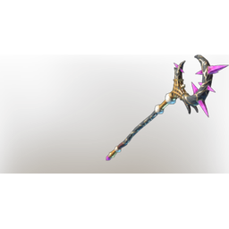

# Darya's Staff

| | |
|---|---|
| Category | [Weapons](../../categories/weapons.md) |
| Rarity | 🔵 Rare |
| Level | 46 |
| Max stack | 1 |
| Item ID | `1271805655` |
| Internal name | `Craft_Weapon_T7_2H_Lore_Staff_ministory_29` |

One of 4 versions of this item: see [Darya's Staff](../../objects/weapons/darya-s-staff.md) for all of them and how they differ.

## Description

A staff that harnesses the power of the eclipsed sun. It functions best when only a crescent of light is left.

---

[← Weapons](../../categories/weapons.md) · [All categories](../../README.md)
