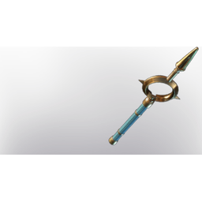

# Darya's Wand

| | |
|---|---|
| Category | [Weapons](../../categories/weapons.md) |
| Rarity | 🟣 Epic |
| Level | 1-55 |
| Max stack | 1 |
| Item ID | `2331017633` |
| Internal name | `Weapon_T5_1H_Lore_Wand_ministory_29_Fog` |

One of 4 versions of this item: see [Darya's Wand](../../objects/weapons/darya-s-wand.md) for all of them and how they differ.

## Description

A wand that harnesses the power of the eclipse. It functions best when the sun is fully submerged in darkness, and only a faint rim of light shines through.

## Stats

| | |
|---|---|
| Slot | Magic weapon |
| Damage type | Shroud |
| Overcharge | 24 |
| Attack Speed | 0.6 s |
| Mana Regeneration | 12 |
| Ethereal Duplication | 30 |

## Enhancements

Unlocked one after another as the item is upgraded, in this order. Armor and damage bonuses grow with the item level, so their numbers are shown in game only.

| | Enhancement | Effect |
|:---:|---|---|
| 1 | Retaliation | A percentage of incoming damage is dealt back to the attacker |
| 2 | Health Leech | On Hit Leech 5% Damage as Health |
| 3 | Retaliation | A percentage of incoming damage is dealt back to the attacker |
| 4 | Mana Leech | On Hit Leech %Percentage% Damage as Mana |
| 5 | Retaliation | A percentage of incoming damage is dealt back to the attacker |

---

[← Weapons](../../categories/weapons.md) · [All categories](../../README.md)
