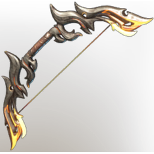

# Draconian Bow

| | |
|---|---|
| Category | [Weapons](../../categories/weapons.md) |
| Rarity | 🔵 Rare |
| Level | 46 |
| Max stack | 1 |
| Item ID | `3626685627` |
| Internal name | `Craft_Weapon_T7_2H_Lore_BowEpic_ministory_19` |

One of 5 versions of this item: see [Draconian Bow](../../objects/weapons/draconian-bow.md) for all of them and how they differ.

## Description

Designed after the wings of the most infamous Kindlewastes dwellers, the Draconian Vulture.

---

[← Weapons](../../categories/weapons.md) · [All categories](../../README.md)
