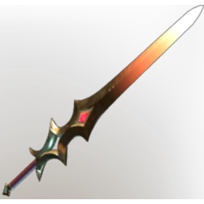

# Enflamed Sword

| | |
|---|---|
| Category | [Weapons](../../categories/weapons.md) |
| Rarity | 🟠 Legendary |
| Level | 1-55 |
| Max stack | 1 |
| Item ID | `518418528` |
| Internal name | `Weapon_T4_1H_SwordEpic_01` |

## Description

A burning sword, glowing of power. It burns hot enough to reduce the mana of its prey with every hit.

## Stats

| | |
|---|---|
| Slot | Melee weapon |
| Damage type | Cutting 50%, Fire 50% |
| Attack Speed | 0.6 s |

## Enhancements

Unlocked one after another as the item is upgraded, in this order. Armor and damage bonuses grow with the item level, so their numbers are shown in game only.

| | Enhancement | Effect |
|:---:|---|---|
| 1 | Heavy | - |
| 2 | Heavy | - |
| 3 | Chargeback | Defeat an enemy to restore Durability |
| 4 | Heavy | - |
| 5 | Precise | +5 Precise |

---

[← Weapons](../../categories/weapons.md) · [All categories](../../README.md) · [JSON](enflamed-sword-518418528.json)
