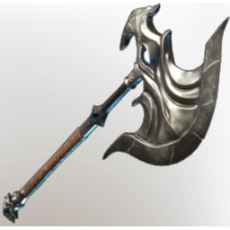

# Enshrouded Axe

| | |
|---|---|
| Category | [Weapons](../../categories/weapons.md) |
| Rarity | 🟠 Legendary |
| Level | 1-55 |
| Max stack | 1 |
| Item ID | `2867801060` |
| Internal name | `Weapon_T3_1H_Axe_01` |

## Description

A mighty axe that spent so much time in the fog that it might've created a personality. It's lusting for blood!

## Stats

| | |
|---|---|
| Slot | Melee weapon |
| Damage type | Cutting |
| Attack Speed | 0.6 s |

## Enhancements

Unlocked one after another as the item is upgraded, in this order. Armor and damage bonuses grow with the item level, so their numbers are shown in game only.

| | Enhancement | Effect |
|:---:|---|---|
| 1 | Heavy | - |
| 2 | Health Leech | +5 Health Leech |
| 3 | Heavy | - |
| 4 | Heavy | - |
| 5 | Health Leech | On Hit Leech 5% Damage as Health |

---

[← Weapons](../../categories/weapons.md) · [All categories](../../README.md) · [JSON](enshrouded-axe-2867801060.json)
