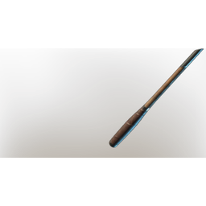

# Epic Fire Wand

| | |
|---|---|
| Category | [Weapons](../../categories/weapons.md) |
| Rarity | ⚪ Common |
| Level | 1-55 |
| Max stack | 1 |
| Item ID | `3851016100` |
| Internal name | `Weapon_T1_1H_WandEpic_01_Fire` |

## Description

Kill it with fire.

## Stats

| | |
|---|---|
| Slot | Magic weapon |
| Damage type | Fire |
| Overcharge | 12 |
| Attack Speed | 0.6 s |
| Mana Regeneration | 4 |

## Enhancements

Unlocked one after another as the item is upgraded, in this order. Armor and damage bonuses grow with the item level, so their numbers are shown in game only.

| | Enhancement | Effect |
|:---:|---|---|
| 1 | Heavy | - |
| 2 | Precise | +4 Precise |
| 3 | Heavy | - |
| 4 | Mana Leech | +3 Mana Leech |
| 5 | Heavy | - |

---

[← Weapons](../../categories/weapons.md) · [All categories](../../README.md)
