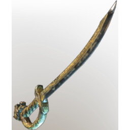

# Epic Sword

| | |
|---|---|
| Category | [Weapons](../../categories/weapons.md) |
| Rarity | ⚪ Common |
| Level | 1-55 |
| Max stack | 1 |
| Item ID | `213584320` |
| Internal name | `Weapon_T2_1H_SwordEpic_02` |

## Description

Every swing is true and just.

## Stats

| | |
|---|---|
| Slot | Melee weapon |
| Damage type | Cutting |
| Attack Speed | 0.6 s |

## Enhancements

Unlocked one after another as the item is upgraded, in this order. Armor and damage bonuses grow with the item level, so their numbers are shown in game only.

| | Enhancement | Effect |
|:---:|---|---|
| 1 | Chargeback | Defeat an enemy to restore Durability |
| 2 |  | - |
| 3 | Retaliation | A percentage of incoming damage is dealt back to the attacker |
| 4 | Health Leech | On Hit Leech 5% Damage as Health |
| 5 | Retaliation | A percentage of incoming damage is dealt back to the attacker |

---

[← Weapons](../../categories/weapons.md) · [All categories](../../README.md) · [JSON](epic-sword-213584320.json)
