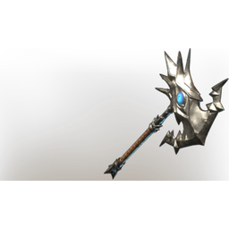

# Epix Fog Axe

| | |
|---|---|
| Category | [Weapons](../../categories/weapons.md) |
| Rarity | 🟠 Legendary |
| Level | 1-55 |
| Max stack | 1 |
| Item ID | `1174019207` |
| Internal name | `Weapon_T3_1H_AxeEpic_01` |

## Description

Epix fog axe descr

## Stats

| | |
|---|---|
| Slot | Melee weapon |
| Damage type | Cutting |
| Attack Speed | 0.6 s |

## Enhancements

Unlocked one after another as the item is upgraded, in this order. Armor and damage bonuses grow with the item level, so their numbers are shown in game only.

| | Enhancement | Effect |
|:---:|---|---|
| 1 | Heavy | - |
| 2 | Precise | +5 Precise |
| 3 | Vicious | +16 Vicious |
| 4 | Precise | +5 Precise |
| 5 | Heavy | - |

---

[← Weapons](../../categories/weapons.md) · [All categories](../../README.md) · [JSON](epix-fog-axe-1174019207.json)
