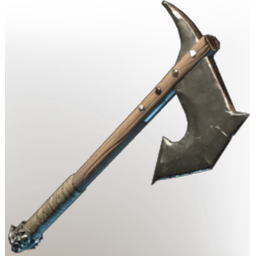

# Fenrig's Axe

| | |
|---|---|
| Category | [Weapons](../../categories/weapons.md) |
| Rarity | 🔵 Rare |
| Level | 6 |
| Max stack | 1 |
| Item ID | `462958958` |
| Internal name | `Craft_Weapon_T1_1H_Lore_Axe_Ministory_10` |

One of 8 versions of this item: see [Fenrig's Axe](../../objects/weapons/fenrig-s-axe.md) for all of them and how they differ.

## Description

An axe, effective when cutting down trees. Slightly less effective for fighting off wolves.

## Stats

| | |
|---|---|
| Slot | Melee weapon |
| Damage type | Cutting |

## Enhancements

Unlocked one after another as the item is upgraded, in this order. Armor and damage bonuses grow with the item level, so their numbers are shown in game only.

| | Enhancement | Effect |
|:---:|---|---|
| 1 |  | - |
| 2 | Precise | +4 Precise |
| 3 |  | - |
| 4 | Health Leech | +3 Health Leech |
| 5 |  | - |

## How to get it

- **Blacksmith**: 4 × [Metal Sheets](../../items/materials/metal-sheets-4271896226.md), 2 × [Charcoal](../../items/materials/charcoal-372029138.md), 3 × [Wood Logs](../../items/materials/wood-logs-722268629.md) → 1 ×

---

[← Weapons](../../categories/weapons.md) · [All categories](../../README.md)
