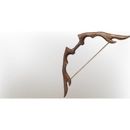

# Forest Bow

| | |
|---|---|
| Category | [Weapons](../../categories/weapons.md) |
| Rarity | 🟠 Legendary |
| Level | 1-55 |
| Max stack | 1 |
| Item ID | `1065913662` |
| Internal name | `Weapon_T2_2H_Bow_02` |

## Description

It was designed in admiration of moose antlers, the king of the forest, and one must say the craftsmen succeeded.

## Stats

| | |
|---|---|
| Slot | Ranged weapon |
| Draw Speed | 1 s |
| Arrow Speed | 33 |

## Enhancements

Unlocked one after another as the item is upgraded, in this order. Armor and damage bonuses grow with the item level, so their numbers are shown in game only.

| | Enhancement | Effect |
|:---:|---|---|
| 1 | Heavy | - |
| 2 | Precise | +4 Precise |
| 3 | Brutal | +14 Brutal |
| 4 | Heavy | - |
| 5 | Brutal | +14 Brutal |

---

[← Weapons](../../categories/weapons.md) · [All categories](../../README.md) · [JSON](forest-bow-1065913662.json)
