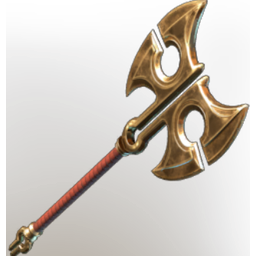

# Golden Recruit Axe

| | |
|---|---|
| Category | [Weapons](../../categories/weapons.md) |
| Rarity | 🟣 Epic |
| Level | 1-55 |
| Max stack | 1 |
| Item ID | `1464929321` |
| Internal name | `Weapon_T6_2H_Lore_GreatAxeEpic_outpost` |

One of 3 versions of this item: see [Golden Recruit Axe](../../objects/weapons/golden-recruit-axe.md) for all of them and how they differ.

## Description

The most successful and newly decorated recruits are sometimes gifted weapons dipped in gold. They aren't anymore hardy, but serve as a status symbol among the group.

## Stats

| | |
|---|---|
| Slot | Melee weapon |
| Damage type | Cutting |
| Attack Speed | 0.774 s |
| Parry Power | 1 |

## Enhancements

Unlocked one after another as the item is upgraded, in this order. Armor and damage bonuses grow with the item level, so their numbers are shown in game only.

| | Enhancement | Effect |
|:---:|---|---|
| 1 | Health Leech | +8 Health Leech |
| 2 |  | - |
| 3 | Chargeback | Defeat an enemy to restore Durability |
| 4 |  | - |
| 5 | Brutal | +20 Brutal |

---

[← Weapons](../../categories/weapons.md) · [All categories](../../README.md)
