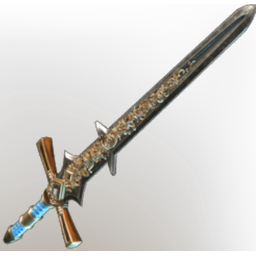

# Greater Twinflame Sword

| | |
|---|---|
| Category | [Weapons](../../categories/weapons.md) |
| Rarity | 🔵 Rare |
| Level | 36 |
| Max stack | 1 |
| Item ID | `3671319442` |
| Internal name | `Craft_Weapon_T6_1H_Lore_SwordEpic_ministory_28` |

One of 4 versions of this item: see [Greater Twinflame Sword](../../objects/weapons/greater-twinflame-sword.md) for all of them and how they differ.

## Description

An elaborate sword, decorated in gold filligre. It came from the skies years ago, and fell into the gaping maw of the Howling Peak.

## Stats

| | |
|---|---|
| Slot | Melee weapon |
| Damage type | Cutting 50%, Fire 50% |
| Attack Speed | 0.6 s |

## Enhancements

Unlocked one after another as the item is upgraded, in this order. Armor and damage bonuses grow with the item level, so their numbers are shown in game only.

| | Enhancement | Effect |
|:---:|---|---|
| 1 | Chargeback | Defeat an enemy to restore Durability |
| 2 |  | - |
| 3 |  | - |
| 4 | Precise | +6 Precise |
| 5 | All Physical Cut Damage | +10 All Physical Cut Damage |

## How to get it

- **Blacksmith**: 4 × [Gold Bars](../../items/materials/gold-bars-514509650.md), 5 × T5 Material Coal Name, 4 × [Copper Bar](../../items/materials/copper-bar-170689373.md), 7 × Aquamarine, 1 × T5 Steel Bar Desc → 1 ×

---

[← Weapons](../../categories/weapons.md) · [All categories](../../README.md) · [JSON](greater-twinflame-sword-3671319442.json)
