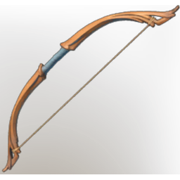

# Hunter's Bow

| | |
|---|---|
| Category | [Weapons](../../categories/weapons.md) |
| Rarity | ⚪ Common |
| Level | 1-55 |
| Max stack | 1 |
| Item ID | `3881967409` |
| Internal name | `Weapon_T1_2H_Bow_01` |

## Description

A finely handcrafted wooden bow, made by a true hunter of the forest.

## Stats

| | |
|---|---|
| Slot | Ranged weapon |
| Draw Speed | 1 s |
| Arrow Speed | 20 |

## Enhancements

Unlocked one after another as the item is upgraded, in this order. Armor and damage bonuses grow with the item level, so their numbers are shown in game only.

| | Enhancement | Effect |
|:---:|---|---|
| 1 | Heavy | - |
| 2 | Vicious | +12 Vicious |
| 3 | Reaping | Defeat an enemy to gain a Stamina Regeneration Buff |
| 4 | Health Leech | On Hit Leech 5% Damage as Health |
| 5 | Heavy | - |

---

[← Weapons](../../categories/weapons.md) · [All categories](../../README.md)
