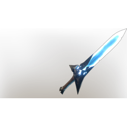

# Ice Blade

| | |
|---|---|
| Category | [Weapons](../../categories/weapons.md) |
| Rarity | 🟠 Legendary |
| Level | 1-55 |
| Max stack | 1 |
| Item ID | `4290427358` |
| Internal name | `Weapon_T3_1H_SwordEpic_02` |

## Description

A magical blade, utilizing the power of ice, with edges so sharp they cut skin upon touch.

## Stats

| | |
|---|---|
| Slot | Melee weapon |
| Damage type | Cutting 50%, Ice 50% |
| Attack Speed | 0.6 s |

## Enhancements

Unlocked one after another as the item is upgraded, in this order. Armor and damage bonuses grow with the item level, so their numbers are shown in game only.

| | Enhancement | Effect |
|:---:|---|---|
| 1 | Heavy | - |
| 2 | Precise | +5 Precise |
| 3 | Heavy | - |
| 4 | Mana Leech | On Hit Leech %Percentage% Damage as Mana |
| 5 | Heavy | - |

---

[← Weapons](../../categories/weapons.md) · [All categories](../../README.md) · [JSON](ice-blade-4290427358.json)
