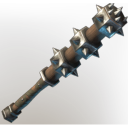

# Iron club

| | |
|---|---|
| Category | [Weapons](../../categories/weapons.md) |
| Rarity | ⚪ Common |
| Level | 1-55 |
| Max stack | 1 |
| Item ID | `102274580` |
| Internal name | `Weapon_T4_1H_Mace_01` |

## Description

A nice mace.

## Stats

| | |
|---|---|
| Slot | Melee weapon |
| Damage type | Blunt |
| Attack Speed | 0.6 s |

## Enhancements

Unlocked one after another as the item is upgraded, in this order. Armor and damage bonuses grow with the item level, so their numbers are shown in game only.

| | Enhancement | Effect |
|:---:|---|---|
| 1 | Heavy | - |
| 2 | Health Leech | +6 Health Leech |
| 3 | Heavy | - |
| 4 | Health Leech | On Hit Leech 5% Damage as Health |
| 5 | Heavy | - |

---

[← Weapons](../../categories/weapons.md) · [All categories](../../README.md)
