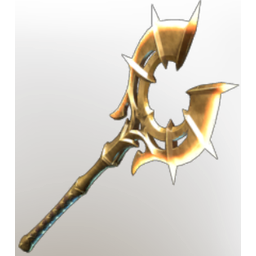

# Jezmina's Apotheosis

| | |
|---|---|
| Category | [Weapons](../../categories/weapons.md) |
| Rarity | 🔵 Rare |
| Level | 26 |
| Max stack | 1 |
| Item ID | `2030714844` |
| Internal name | `Craft_Weapon_T5_1H_Lore_AxeEpic_Ministory_02` |

One of 6 versions of this item: see [Jezmina's Apotheosis](../../objects/weapons/jezmina-s-apotheosis.md) for all of them and how they differ.

## Description

An axe  which carves a path through enemies no matter what. Swinging it fearlessly makes it feel light as a feather.

## Stats

| | |
|---|---|
| Slot | Melee weapon |
| Damage type | Cutting 50%, Fire 50% |
| Attack Speed | 0.6 s |

## Enhancements

Unlocked one after another as the item is upgraded, in this order. Armor and damage bonuses grow with the item level, so their numbers are shown in game only.

| | Enhancement | Effect |
|:---:|---|---|
| 1 | Heavy | - |
| 2 |  | - |
| 3 | Heavy | - |
| 4 | Health Leech | On Hit Leech 5% Damage as Health |
| 5 | Brutal | +20 Brutal |

## How to get it

- **Blacksmith**: 4 × T5 Steel Bar Desc, 3 × [Aurum Lily](../../items/materials/aurum-lily-2341333485.md), 8 × [Amber](../../items/materials/amber-1862351329.md), 3 × [Conifer Logs](../../items/materials/conifer-logs-1475408789.md) → 1 ×

---

[← Weapons](../../categories/weapons.md) · [All categories](../../README.md)
