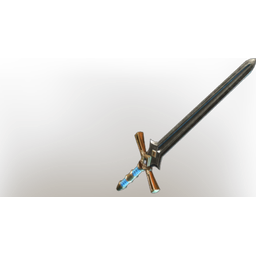

# Lesser Twinflame Sword

| | |
|---|---|
| Category | [Weapons](../../categories/weapons.md) |
| Rarity | 🔵 Rare |
| Level | 26 |
| Max stack | 1 |
| Item ID | `2773595146` |
| Internal name | `Craft_Weapon_T5_1H_Lore_Sword_ministory_28` |

## Description

A weapon that was rumored to have fallen from the stars. It crashed down to Embervale, where it pierced a stone as it landed. Stuck there, it waited for years to be freed.

---

[← Weapons](../../categories/weapons.md) · [All categories](../../README.md)
