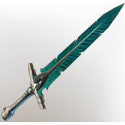

# Lord Vorgoth's Sword

| | |
|---|---|
| Category | [Weapons](../../categories/weapons.md) |
| Rarity | 🟠 Legendary |
| Level | 1-55 |
| Max stack | 1 |
| Item ID | `1237806794` |
| Internal name | `Weapon_T6_2H_Lore_GreatSwordEpic_Ministory_20` |

One of 3 versions of this item: see [Lord Vorgoth's Sword](../../objects/weapons/lord-vorgoth-s-sword.md) for all of them and how they differ.

## Description

Lord Vorgoth's trusty blade. It was discarded before the war, and replaced by a weapon more befitting of vile acts.

---

[← Weapons](../../categories/weapons.md) · [All categories](../../README.md)
