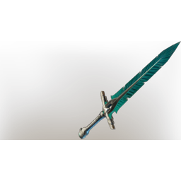

# Lord Vorgoth's Sword

| | |
|---|---|
| Category | [Weapons](../../categories/weapons.md) |
| Rarity | 🔵 Rare |
| Level | 46 |
| Max stack | 1 |
| Item ID | `1367103932` |
| Internal name | `Craft_Weapon_T7_2H_Lore_GreatSwordEpic_Ministory_20` |

## Description

Lord Vorgoth's trusty blade. It was discarded before the war, and replaced by a weapon more befitting of vile acts.

---

[← Weapons](../../categories/weapons.md) · [All categories](../../README.md)
