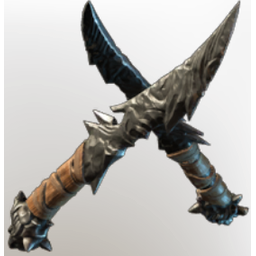

# Lupa's scalper

| | |
|---|---|
| Category | [Weapons](../../categories/weapons.md) |
| Rarity | 🟠 Legendary |
| Level | 1-55 |
| Max stack | 1 |
| Item ID | `3548335929` |
| Internal name | `Weapon_T3_1H_Lore_DaggersEpic_DPS_hunter_hint04` |

One of 6 versions of this item: see [Lupa's scalper](../../objects/weapons/lupa-s-scalper.md) for all of them and how they differ.

## Description

"A Shadow over Umber Hollow -Lupa" is etched on the side.

## Stats

| | |
|---|---|
| Slot | Melee weapon |
| Damage type | Piercing |
| Attack Speed | 0.4 s |

## Enhancements

Unlocked one after another as the item is upgraded, in this order. Armor and damage bonuses grow with the item level, so their numbers are shown in game only.

| | Enhancement | Effect |
|:---:|---|---|
| 1 | Heavy | - |
| 2 | Precise | +7 Precise |
| 3 | Heavy | - |
| 4 | Vicious | +16 Vicious |
| 5 | Heavy | - |

---

[← Weapons](../../categories/weapons.md) · [All categories](../../README.md) · [JSON](lupa-s-scalper-3548335929.json)
