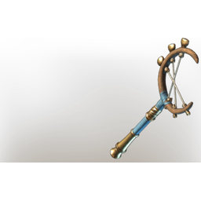

# Proto Bone-Bender

| | |
|---|---|
| Category | [Weapons](../../categories/weapons.md) |
| Rarity | 🟠 Legendary |
| Level | 1-55 |
| Max stack | 1 |
| Item ID | `1030886695` |
| Internal name | `Weapon_T7_1H_Lore_Wand_protoVessels_blunt` |

## Description

A traditional wand that helps to adjust the subject's bones after arrival.

---

[← Weapons](../../categories/weapons.md) · [All categories](../../README.md)
