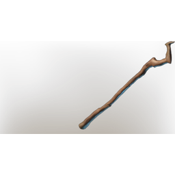

# Shepard's Staff

| | |
|---|---|
| Category | [Weapons](../../categories/weapons.md) |
| Rarity | ⚪ Common |
| Level | 1-55 |
| Max stack | 1 |
| Item ID | `1157288032` |
| Internal name | `Weapon_T1_2H_Staff_01` |

## Description

A potent staff capable of protecting those who cannot protectsthemselfs.

## Stats

| | |
|---|---|
| Slot | Ranged weapon |

## Enhancements

Unlocked one after another as the item is upgraded, in this order. Armor and damage bonuses grow with the item level, so their numbers are shown in game only.

| | Enhancement | Effect |
|:---:|---|---|
| 1 | Heavy | - |
| 2 | Mana Leech | +3 Mana Leech |
| 3 | Heavy | - |
| 4 | +1 Mana Currents | Increases the skill level of Mana Currents by +1 |
| 5 | Precise | +4 Precise |

---

[← Weapons](../../categories/weapons.md) · [All categories](../../README.md)
