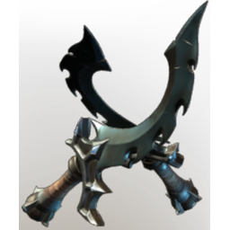

# Shroud Lair Daggers

| | |
|---|---|
| Category | [Weapons](../../categories/weapons.md) |
| Rarity | 🟠 Legendary |
| Level | 1-55 |
| Max stack | 1 |
| Item ID | `2796408306` |
| Internal name | `Weapon_TX_2H_Daggers_DPS_FogNest` |

## Description

A pair of Daggers infused by the Shroud. Hidden in the deepest depths of Shroud Lairs.

## Stats

| | |
|---|---|
| Slot | Melee weapon |
| Damage type | Piercing 50%, Shroud 50% |
| Parry Power | 1 |
| Attack Speed | 0.4 s |

## Enhancements

Unlocked one after another as the item is upgraded, in this order. Armor and damage bonuses grow with the item level, so their numbers are shown in game only.

| | Enhancement | Effect |
|:---:|---|---|
| 1 | Vicious | +24 Vicious |
| 2 | Heavy | - |
| 3 | Precise | +9 Precise |
| 4 | Heavy | - |
| 5 | Vicious | +24 Vicious |

---

[← Weapons](../../categories/weapons.md) · [All categories](../../README.md) · [JSON](shroud-lair-daggers-2796408306.json)
