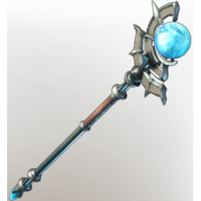

# Shroud Lair Staff

| | |
|---|---|
| Category | [Weapons](../../categories/weapons.md) |
| Rarity | 🟠 Legendary |
| Level | 1-55 |
| Max stack | 1 |
| Item ID | `1404050036` |
| Internal name | `Weapon_TX_2H_Staff_FogNest` |

## Description

An omnipotent Staff infused by the Shroud. Hidden in the deepest depths of Shroud Lairs.

## Stats

| | |
|---|---|
| Slot | Ranged weapon |

## Enhancements

Unlocked one after another as the item is upgraded, in this order. Armor and damage bonuses grow with the item level, so their numbers are shown in game only.

| | Enhancement | Effect |
|:---:|---|---|
| 1 | Heavy | - |
| 2 | Mana Leech | On Hit Leech %Percentage% Damage as Mana |
| 3 | Heavy | - |
| 4 | Precise | +7 Precise |
| 5 | Nebulous | +10 Nebulous |

---

[← Weapons](../../categories/weapons.md) · [All categories](../../README.md) · [JSON](shroud-lair-staff-1404050036.json)
