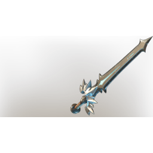

# Shroud Lair Sword

| | |
|---|---|
| Category | [Weapons](../../categories/weapons.md) |
| Rarity | 🟣 Epic |
| Level | 1-55 |
| Max stack | 1 |
| Item ID | `66688434` |
| Internal name | `Weapon_TX_1H_Sword_FogNest` |

## Description

A sleek sword infused by the Shroud. Hidden in the deepest depths of Shroud Lairs.

## Stats

| | |
|---|---|
| Slot | Melee weapon |
| Damage type | Cutting 50%, Shroud 50% |
| Attack Speed | 0.6 s |

## Enhancements

Unlocked one after another as the item is upgraded, in this order. Armor and damage bonuses grow with the item level, so their numbers are shown in game only.

| | Enhancement | Effect |
|:---:|---|---|
| 1 | Precise | +7 Precise |
| 2 | Heavy | - |
| 3 | Health Leech | On Hit Leech 5% Damage as Health |
| 4 | Heavy | - |
| 5 | Brutal | +24 Brutal |

---

[← Weapons](../../categories/weapons.md) · [All categories](../../README.md)
