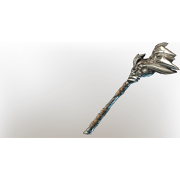

# Shroud Weaver

| | |
|---|---|
| Category | [Weapons](../../categories/weapons.md) |
| Rarity | 🔵 Rare |
| Level | 46 |
| Max stack | 1 |
| Item ID | `1069361064` |
| Internal name | `Craft_Weapon_T7_2H_Lore_StaffEpic_ministory_17` |

One of 5 versions of this item: see [Shroud Weaver](../../objects/weapons/shroud-weaver.md) for all of them and how they differ.

## Description

A malicious staff that effortlessly intertwines the strings of fate with the Shroud.

## Stats

| | |
|---|---|
| Slot | Ranged weapon |

## Enhancements

Unlocked one after another as the item is upgraded, in this order. Armor and damage bonuses grow with the item level, so their numbers are shown in game only.

| | Enhancement | Effect |
|:---:|---|---|
| 1 | Heavy | - |
| 2 | Brutal | +24 Brutal |
| 3 | +1 Mana Currents | Increases the skill level of Mana Currents by +1 |
| 4 | Heavy | - |
| 5 | Nebulous | +10 Nebulous |

## How to get it

- **Alchemist**: 2 × [Celesthium Bars](../../items/materials/celesthium-bars-2893592883.md), 2 × [Glass](../../items/materials/glass-2246309017.md), 2 × [Moonstone Dust](../../items/materials/moonstone-dust-4078086541.md), 2 × [Shroud Adhesive](../../items/materials/shroud-adhesive-1047122195.md) → 1 ×

---

[← Weapons](../../categories/weapons.md) · [All categories](../../README.md) · [JSON](shroud-weaver-1069361064.json)
