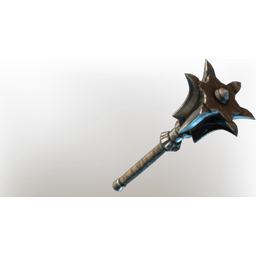

# Six Edged Mace

| | |
|---|---|
| Category | [Weapons](../../categories/weapons.md) |
| Rarity | ⚪ Common |
| Level | 1-55 |
| Max stack | 1 |
| Item ID | `4110381914` |
| Internal name | `Weapon_T1_1H_MaceEpic_01` |

## Description

A mace with a heavy head

## Stats

| | |
|---|---|
| Slot | Melee weapon |
| Damage type | Blunt |
| Attack Speed | 0.6 s |

## Enhancements

Unlocked one after another as the item is upgraded, in this order. Armor and damage bonuses grow with the item level, so their numbers are shown in game only.

| | Enhancement | Effect |
|:---:|---|---|
| 1 | Merciless | +12 Merciless |
| 2 | Heavy | - |
| 3 | Heavy | - |
| 4 | Merciless | +12 Merciless |
| 5 | Retaliation | A percentage of incoming damage is dealt back to the attacker |

---

[← Weapons](../../categories/weapons.md) · [All categories](../../README.md) · [JSON](six-edged-mace-4110381914.json)
