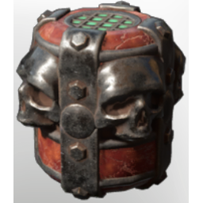

# Skull Companion

| | |
|---|---|
| Category | [Weapons](../../categories/weapons.md) |
| Rarity | ⚪ Common |
| Level | 15 |
| Max stack | 20 |
| Item ID | `3124613974` |
| Internal name | `Consumable_Necromancer_Grenade_T2` |

## Description

Throw to summon a skull companion.

## Where to find

Crafting, Collector

## Stats

| | |
|---|---|
| Slot | Magic weapon |
| Damage type | Fire |
| Mana Cost | 30 |
| Duration | 1:00 min |
| Throw Interval | 1,000 |

## How to get it

- **Collector**: 5 × [Bonemeal](../../items/materials/bonemeal-2982735558.md), 2 × [Metal Scraps](../../items/materials/metal-scraps-132545371.md), 6 × T2 Green Essence → 3 ×

---

[← Weapons](../../categories/weapons.md) · [All categories](../../README.md)
