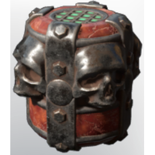

# Skull companion Level 20

| | |
|---|---|
| Category | [Weapons](../../categories/weapons.md) |
| Rarity | 🔵 Rare |
| Level | 25 |
| Max stack | 20 |
| Item ID | `305542871` |
| Internal name | `Consumable_Necromancer_Grenade_T4` |

## Description

Throw to summon a skull companion.

## Where to find

Crafting, Collector

## Stats

| | |
|---|---|
| Slot | Magic weapon |
| Damage type | Fire |
| Mana Cost | 90 |
| Duration | 2:00 min |
| Throw Interval | 1,000 |

## How to get it

- **Collector**: 5 × [Bonemeal](../../items/materials/bonemeal-2982735558.md), 2 × [Metal Scraps](../../items/materials/metal-scraps-132545371.md), 6 × [T3 Green essence](../../items/materials/t3-green-essence-1453689781.md) → 3 ×

---

[← Weapons](../../categories/weapons.md) · [All categories](../../README.md)
