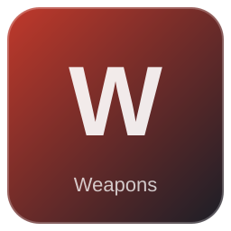

# Skull companion Level 20

| | |
|---|---|
| Category | [Weapons](../../categories/weapons.md) |
| Rarity | 🔵 Rare |
| Level | 25 |
| Max stack | 20 |
| Item ID | `305542871` |
| Internal name | `Consumable_Necromancer_Grenade_T4` |

## Description

Throw to summon a skull companion.

## Where to find

Crafting, Collector

---

[← Weapons](../../categories/weapons.md) · [All categories](../../README.md)
