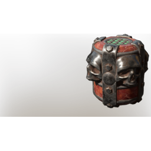

# Skull Summoning Vessel

| | |
|---|---|
| Category | [Weapons](../../categories/weapons.md) |
| Rarity | 🟠 Legendary |
| Level | 40 |
| Max stack | 20 |
| Item ID | `1596935538` |
| Internal name | `Consumable_Necromancer_Grenade_T6` |

## Description

Throw to summon a skull companion.

## Where to find

Crafting, Collector

---

[← Weapons](../../categories/weapons.md) · [All categories](../../README.md)
